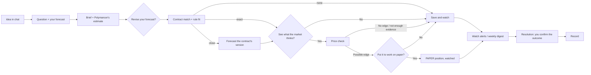

# Polymancer: experience

How Polymancer looks and flows, from the first sentence a user types to the day their question resolves. Component details are in [interface.md](interface.md); agent behavior is in [agent.md](agent.md).

## Places

Polymancer has three places. Every client shows them the same way; only the layout changes.

| Place         | What it is                                                                                            | Lives where                    |
| ------------- | ----------------------------------------------------------------------------------------------------- | ------------------------------ |
| **Ask**       | The conversation where an idea becomes a question. Home.                                              | Chat                           |
| **Questions** | Every question you've saved, grouped as Drafts, Watching and Resolved. Opening one shows its dossier. | List plus the Question dossier |
| **Record**    | Your track record: resolved questions, scores and, once there is enough data, calibration.            | Record view                    |

The **Question** is the lasting object. Chat is how a Question starts; the dossier is where it lives; the Record is its history.

### Web layout

```text
┌────────────┬───────────────────────────────┬──────────────────────────────┐
│ Ask        │  Chat                         │  Question dossier            │
│ Questions  │                               │  ┌────────────────────────┐  │
│  Drafts    │  You: I think the Fed cuts     │  │ Will the Fed cut rates │  │
│  Watching  │  before March.                 │  │ before Mar 31, 2027?   │  │
│  Resolved  │                               │  │ Your forecast  60%     │  │
│ Record     │  Polymancer: Do you mean any   │  │ Polymancer   45–55%    │  │
│            │  cut at a scheduled meeting... │  │ Market        38%      │  │
│ Topics     │                               │  │ PAPER · max loss $40   │  │
│            │  [Question card, inline]       │  └────────────────────────┘  │
│            │                               │  Brief · Match · Price check │
└────────────┴───────────────────────────────┴──────────────────────────────┘
```

- The dossier follows the Question being discussed. Without one, it shows the Questions list.
- On narrow screens the dossier becomes a sheet opened from the inline card.
- In M1 the Question card lives in the dossier and chat replies use structured text. The inline chat card arrives in M2 ([system.md](system.md#client-surfaces)).

### ChatGPT app

The same Question card renders as an inline widget in a ChatGPT conversation, with an expand control for the brief and rule fit. It covers asking, briefs, matching, price checks, paper positions and digests. It never offers real-money orders or links that complete a trade, and upgrades happen on the web (see [system.md](system.md#client-surfaces)).

### Mobile

Mobile is a full client with the same power as the web console:

- Ask (chat with the Question card inline);
- the Questions list and dossier, shown as a full-screen sheet;
- briefs, matching, price checks and paper positions;
- the Record and call cards;
- settings.

It adds what only a phone does well: push watch alerts that open straight onto the changed Question, quick forecast revision, and outcome confirmation from the notification.

## The loop



Every exit is a complete outcome. A saved Question with no market and no position still earns a place in the Record when it resolves.

## First session

A worked example: Maya, 34, follows AI policy closely and has never traded a prediction market.

1. **Arrive.** Home is Ask, with one prompt: _"What do you think will happen?"_
   - Below it, Maya can pick her topics: Politics, Economy, Tech & AI, Science, World.
   - Three timely starters in those topics are offered for anyone without an idea yet. A starter is an open question, never a market or a price.
2. **Say the idea.** Maya types: _"The EU AI Act enforcement is going to slip."_
3. **Sharpen.** Polymancer asks only what is missing, one question at a time:
   - _Slip_ how: delayed general-purpose AI obligations, or fines not issued?
   - By when?
   - What would show it happened?

   It drafts: **"Will the EU formally delay the AI Act's general-purpose AI obligations beyond August 2, 2027, by June 30, 2027?"**, with resolution criteria (an official EU publication) and a fallback if that source is unclear.

4. **Commit a forecast.** Before showing anything else, Polymancer asks how likely Maya thinks it is (with a range if she's unsure) and her strongest reason on each side. She sets **70%**: _"the Commission already signaled flexibility"_ for, and _"member states want the deadline kept"_ against. It is saved with a timestamp and never overwritten.
5. **Brief.** Polymancer researches, showing progress as it goes:
   - a base rate (how often similar EU deadlines slipped);
   - the strongest case for and against, with dated sources;
   - what would change the estimate.

   It reveals its own estimate: **55–65%, point 60%**, with two sentences of reasoning.

6. **Revise or keep.** Polymancer asks whether Maya wants to keep 70% or revise. She keeps it; both numbers stay on record.
7. **Match.** Polymancer finds one Polymarket contract and one Kalshi contract and shows rule fit for each (✓ matches / ✗ differs):

   | Contract   | Wording                   | Deadline            | Resolution source | Level   |
   | ---------- | ------------------------- | ------------------- | ----------------- | ------- |
   | Polymarket | ✓                         | ✗ ends Dec 31, 2026 | ✓                 | close   |
   | Kalshi     | ✗ "any provision delayed" | ✓                   | ✓                 | related |

   _"Neither asks exactly your question. The Polymarket contract asks the same thing with a shorter deadline. Want to forecast that version too, before we look at its price?"_

8. **Forecast the contract's version (optional).** Maya agrees.
   - Polymancer drafts the child Question, _"…by December 31, 2026?"_, and Maya commits **45%** for the shorter window.
   - The brief updates: Polymancer's estimate is **35–45% (40%)**.
   - Her original June 2027 Question stays saved and watched on its own.
9. **Save and watch** is the default next step. Maya instead taps the optional **See what the market thinks**. The price check shows:
   - Maya's 45%;
   - Polymancer's 35–45%;
   - the market after spread and fees for a small size: 31%.

   Verdict: **Possible edge**. The low end of Polymancer's range clears the executable price by at least the buffer. The gap is shown at Maya's forecast and at Polymancer's, separately.

10. **Put it to work on paper (opt-in).** Maya chooses to.
    - She sets a **maximum loss of $25**. Polymancer shows the paper shares, the entry price after costs, and both outcomes in plain words.
    - She reviews the Question, contract and max loss, then taps **Record paper position**.
    - The card turns to **PAPER · Watching**, with a short undo.
11. **Leave.** Polymancer says what it will watch (the official journal, the committee vote, the contract price) and that it will only reach out if something changes the reasoning.

When no contract is close, steps 8–10 are skipped and the Question is saved and watched until its deadline. A "no edge" verdict ends at step 9 with **Save and watch**; Polymancer doesn't suggest a position.

## Coming back

Polymancer earns returns with relevance, not volume.

**Watch alerts** arrive only for material changes (the triggers are defined in [agent.md](agent.md#watch-rules)):

- new evidence on a signpost named in the brief;
- a big move in the matched contract's price;
- a change to its rules or deadline;
- a week to go;
- resolution.

Each alert says what changed, what didn't, and what it means for the original reasoning. It ends with a choice: keep, revise your forecast, close the paper position, or ignore. Polymancer never changes a forecast or position on the user's behalf.

**Weekly digest** (opt-in; Free gets a weekly check-in):

- the status of watched Questions;
- up to three new questions worth having a view on in the user's topics.

A digest question opens in Ask and asks for the user's forecast before showing any price.

**Silence is a feature.** With no material change, Polymancer stays quiet.

## Resolution day

1. When the deadline passes or a matched contract settles, Polymancer **proposes an outcome** for the Question against its own criteria, with evidence.
2. The user **confirms, corrects, or marks it unresolved**. Only confirmed outcomes are scored.
3. The paper position settles on the **contract's payout**. For a child Question that payout is the outcome; the parent Question resolves on its own deadline: _"Your December question: no. Your June question: still open."_
4. The Question moves to Resolved with its forecasts, the brief at the time, the outcome and a short **"what would you do differently?"** prompt.

## Record

Scoring rules live in [system.md](system.md#scoring); this is what the user sees.

- **Early on:** each resolved Question with your forecast, Polymancer's estimate, the market (exact matches only) and the outcome. Each gets a score explained in words ("lower is better; a coin flip scores 0.25"), and running averages carry sample counts. No conclusions are drawn from a handful of outcomes.
- **With enough history:** a calibration chart with honest uncertainty ranges, for you and for Polymancer, and topics where you are sharper or weaker when the sample supports it.
- **Paper results** come second, separately, so luck doesn't pose as skill.

## Sharing: the call card

A call card is a timestamped record of a view, not a tip.

- **Available only after** the user has committed a forecast. Cards are private by default and shared by explicit choice.
- **Contains:**
  - the Question and its resolution criteria;
  - the commit timestamp;
  - the user's forecast and any revisions;
  - a snapshot of Polymancer's estimate and the market price, each labelled and timestamped;
  - a one-line rationale;
  - later, the outcome.
- **Never contains:** position size, profit, "buy" language, or a link that opens a trade.
- The shared view updates on resolution, so the card becomes proof of having called it, or of having been honest when wrong.

## Recovery paths

Error handling and staleness rules are in [system.md](system.md#errors-and-staleness); these are the user-facing moments.

| Situation                                   | What Polymancer does                                                                                   |
| ------------------------------------------- | ------------------------------------------------------------------------------------------------------ |
| Idea too vague after three clarifying turns | Offers two concrete readings and asks the user to pick one, or saves a draft                           |
| No contract asks the Question               | Says so, saves and watches the Question, and offers close contracts' terms as optional child Questions |
| Research sources are thin or stale          | Shows "not enough evidence" with what is missing; no estimate is forced                                |
| Market data unavailable                     | Keeps the last good quote with its age; disables paper positions until fresh                           |
| Book too thin for the size                  | Shows the largest size that fits, or "no edge"                                                         |
| User disagrees with the brief               | Records the disagreement and the user's reason, and can research the user's counterpoint               |
| Research budget used up                     | Explains the limit, offers standard research, and shows when it resets                                 |
